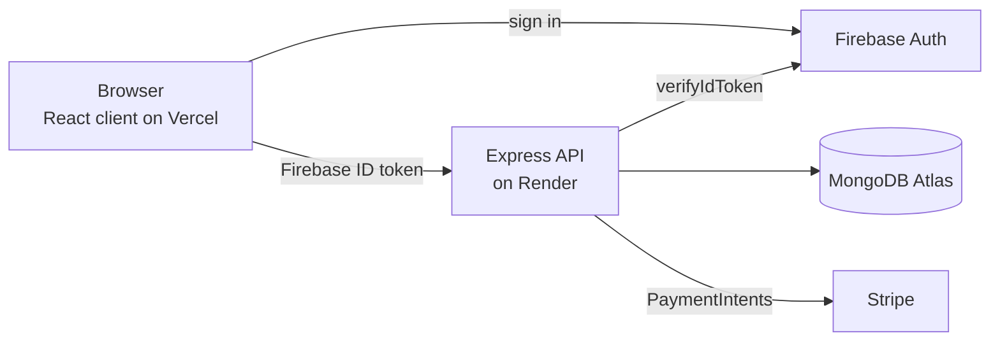
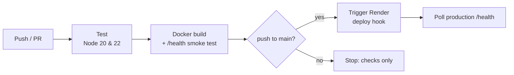

# ZapShift Server

[](https://github.com/hossenra/Zap-shift-server/actions/workflows/ci-cd.yml)

REST API for **ZapShift**, a parcel delivery platform where customers book and pay for deliveries, admins approve riders and assign parcels, and riders update delivery status in real time.

Frontend: [Zap-shift-client](https://github.com/hossenra/Zap-shift-client)

## Tech stack

| Layer | Technology |
| --- | --- |
| Runtime | Node.js 22, Express 5 |
| Database | MongoDB Atlas (official driver) |
| Auth | Firebase Authentication, verified server-side with Firebase Admin SDK |
| Payments | Stripe Payment Intents |
| Testing | Node's built-in test runner (`node --test`) |
| Container | Docker (Alpine, non-root user, healthcheck) |
| CI/CD | GitHub Actions → Render |

## Architecture



Every protected request carries a Firebase ID token in the `Authorization: Bearer <token>` header. The API verifies it with the Firebase Admin SDK, then checks the user's **role** (`user`, `rider`, `admin`) stored in MongoDB.

## Features

- **Role-based access control**: `verifyFBToken`, `verifyAdmin` and `verifyRider` middlewares
- **Parcels**: create, list, delete; owners only see their own parcels, admins see everything
- **Rider workflow**: apply → admin approves/deactivates → admin assigns parcels by district → rider marks `delivered` / `delivery_failed`
- **Tracking timeline**: every status change is written to a `tracking` collection, publicly readable by tracking ID
- **Payments**: Stripe PaymentIntent is verified server-side (`status === "succeeded"`) before a parcel is marked paid
- **Safe search**: user input is regex-escaped before MongoDB `$regex` queries
- **Health endpoint** (`/health`) used by Docker, Render and the deploy pipeline

## API overview

| Method | Endpoint | Access |
| --- | --- | --- |
| GET | `/health` | Public |
| POST | `/users` | Public (on sign-up) |
| GET | `/users/role/:email` | Logged-in (self) |
| GET | `/users/search?search=` | Admin |
| PATCH | `/users/admin/:id` · `/users/remove-admin/:id` | Admin |
| POST | `/riders` | Logged-in |
| GET | `/riders` · `/riders/pending` · `/riders/active` · `/riders/deactivated` | Admin |
| GET | `/riders/active-by-district?district=` | Admin |
| PATCH | `/riders/:id` · `/riders/activate/:id` · `/riders/deactivate/:id` | Admin |
| GET / POST | `/parcels` | Logged-in |
| GET / DELETE | `/parcels/:id` | Owner, assigned rider or admin |
| GET | `/parcels/ready-for-assignment` | Admin |
| PATCH | `/parcels/assign-rider/:id` | Admin |
| GET | `/parcels/rider-pending` · `/parcels/rider-completed` | Rider |
| PATCH | `/parcels/rider-status/:id` | Rider (assigned) |
| POST | `/tracking` | Admin |
| GET | `/tracking/:trackingId` | Public |
| POST | `/create-checkout-session` | Logged-in |
| GET / POST | `/payments` | Logged-in |

## Run locally

Requirements: Node.js 20+, a MongoDB Atlas cluster, a Firebase project and a Stripe test account.

```bash
git clone https://github.com/hossenra/Zap-shift-server.git
cd Zap-shift-server
npm install
cp .env.example .env        # then fill in your values
```

Download a Firebase service account key (Firebase Console → Project settings → Service accounts → *Generate new private key*) and save it as `firebase-admin-key.json` in the project root. It is git-ignored.

```bash
npm run dev    # auto-restarts on changes
# or
npm start
```

The API runs on `http://localhost:4000`. Check `http://localhost:4000/health`.

### Environment variables

| Variable | Required | Description |
| --- | --- | --- |
| `PORT` | no | Defaults to `4000` |
| `DB_USER` / `DB_PASS` | yes* | MongoDB Atlas user and password |
| `MONGODB_URI` | no | Full connection string; overrides `DB_USER` / `DB_PASS` |
| `PAYMENT_GATEWAY_KEY` | yes | Stripe secret key |
| `FIREBASE_SERVICE_KEY` | prod | Base64 of the service account JSON (`base64 -i firebase-admin-key.json \| tr -d '\n'`) |
| `CLIENT_URL` | no | Allowed CORS origins, comma-separated. Empty = allow all |

## Tests

```bash
npm test
```

The smoke tests start the app on a random port and check the public endpoints, input validation, and that protected routes return `401`/`403` without a valid token. They need no database or API keys, so they run identically in CI.

## Docker

```bash
docker build -t zap-shift-server .
docker run -p 4000:4000 --env-file .env zap-shift-server
```

The image installs production dependencies only, runs as the non-root `node` user and has a built-in `HEALTHCHECK` on `/health`.

## CI/CD pipeline



Defined in [`.github/workflows/ci-cd.yml`](.github/workflows/ci-cd.yml):

1. **Test**: `npm ci`, syntax check, `npm test`, `npm audit` on a Node 20/22 matrix
2. **Docker**: builds the production image, runs it and waits for `/health`
3. **Deploy** (only on `main`, only if 1 and 2 pass): calls the Render deploy hook, then polls the live `/health` endpoint

Pull requests run steps 1 and 2 only, so nothing reaches production without passing checks. Render's own auto-deploy is disabled in `render.yaml` so the pipeline is the single path to production.

### Deployment setup (one-time)

1. **Render** → *New* → *Blueprint* → select this repo. Render reads `render.yaml`.
2. Fill in the environment variables in the Render dashboard (`DB_USER`, `DB_PASS`, `PAYMENT_GATEWAY_KEY`, `FIREBASE_SERVICE_KEY`, `CLIENT_URL` = your Vercel URL).
3. **MongoDB Atlas** → *Network Access* → allow `0.0.0.0/0` (Render's free tier has no fixed IP).
4. Render service → *Settings* → *Deploy Hook* → copy the URL.
5. GitHub repo → *Settings* → *Secrets and variables* → *Actions*:
   - Secret `RENDER_DEPLOY_HOOK_URL` = the deploy hook URL
   - Variable `API_URL` = `https://<your-service>.onrender.com`

After that, every merge to `main` is tested, containerised and deployed automatically.

## Security notes

- Secrets live in `.env` / platform environment variables and are git-ignored; `.env.example` documents them.
- The Firebase service account is loaded from an environment variable in production, never from the repository.
- Users can only read their own parcels and payments; ownership is checked server-side on every request.
- Payment status is confirmed with Stripe before anything is written to the database.
